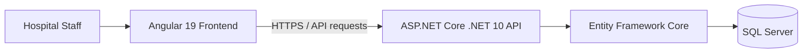

# Hospital Management SaaS Platform

<p align="center">
  <strong>Healthcare operations management built with Angular and ASP.NET Core</strong>
</p>

<p align="center">
  
  
  
  
</p>

## Overview

A healthcare operations application built with Angular 19, .NET 10, Entity Framework Core, and Microsoft SQL Server. The solution covers patient administration, clinical workflows, appointments, inpatient operations, diagnostics, pharmacy, and billing.

## Core modules

| Module | Scope |
| --- | --- |
| Patient administration | Patient registration and identity-document input with country-specific formatting |
| Workforce | Doctor and staff administration, specialties, and consultation fees |
| Appointments | Patient-doctor appointment scheduling |
| Inpatient | Admissions, beds, rooms, wards, and occupancy tracking |
| Clinical | Encounters, diagnosis coding, examinations, and prescriptions |
| Diagnostics | Laboratory and radiology orders and result entry |
| Pharmacy | Inventory, suppliers, and procurement workflows |
| Billing | Invoices, payments, and insurance information |
| Access control | Role-based access for administrative and clinical staff |
| Tenant data | Multi-tenant data access patterns |

## Demo walkthrough

A recorded walkthrough is available in the portfolio repository:

[Watch the Hospital SaaS demo](https://raw.githubusercontent.com/abdullahzulfiqar137/Portfolio/main/public/assets/videos/hospital-saas-demo.mp4)

## Architecture at a glance

The repository contains an Angular frontend and an ASP.NET Core API. Entity Framework Core provides the data-access layer to Microsoft SQL Server.



## Technology stack

| Layer | Technology |
| --- | --- |
| Frontend | Angular 19, TypeScript, Signals, Standalone Components |
| Styling | SCSS |
| Backend | .NET 10, ASP.NET Core Web API |
| Data access | Entity Framework Core |
| Database | Microsoft SQL Server |
| Security | JWT bearer authentication and tenant-aware query filtering |

## Repository structure

```text
.
├── backend/
│   ├── HospitalSaaS.sln
│   └── src/
│       └── HospitalSaaS.Api/
└── frontend/
    ├── Dockerfile
    └── README.md
```

## Prerequisites

- .NET 10 SDK
- Node.js and npm compatible with Angular 19
- SQL Server, LocalDB, or SQL Server Express

## Run locally

### 1. Configure the database

Review the backend development configuration and set a local SQL Server connection string using development-only settings or environment variables. Never commit real credentials.

### 2. Apply migrations and start the API

```bash
cd backend/src/HospitalSaaS.Api
dotnet ef database update
dotnet run
```

The project documentation identifies https://localhost:7001 or http://localhost:5000 as API addresses. Confirm the actual bound address in application startup output.

### 3. Start the frontend

```bash
cd frontend
npm install
npm start
```

Open [http://localhost:4200](http://localhost:4200).

## Privacy and security

- Use synthetic test data only in development and demonstrations.
- Do not commit patient information, medical records, access tokens, connection strings, or other sensitive data.
- Use unique development credentials and secure production identity provisioning.
- Earlier shared demo passwords have been removed from public documentation. Rotate any credential that may have been used outside a local environment and disable predictable seeded accounts before deployment.

## Further documentation

- [Backend setup and API notes](backend/README.md)
- [Frontend setup notes](frontend/README.md)

## Security

See [SECURITY.md](SECURITY.md) for vulnerability reporting and healthcare-data safety notes.

## License

The previous README identified the project as MIT-licensed. Verify that a matching `LICENSE` file exists before redistributing the project under that license.
